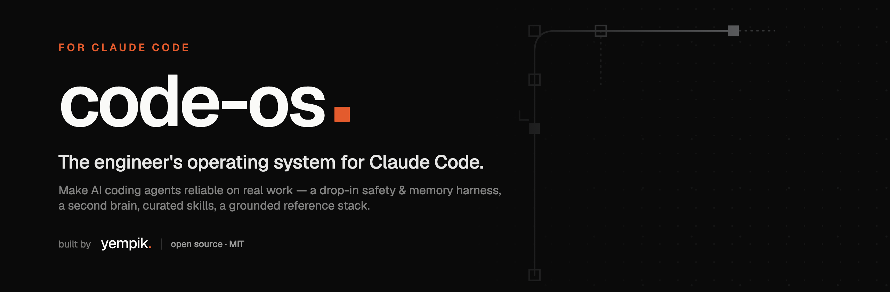

<div align="center">



<sub><a href="README.md">English</a> · <b>Italiano</b></sub>

# `code-os`

### Il sistema operativo dell'ingegnere per Claude Code.

Rendi affidabili gli agenti di coding sul lavoro vero — non un autocomplete furbo. **Un orchestratore, più modelli, disciplina basata su file**: orchestrazione di subagent CLI cross-vendor, un harness di sicurezza + memoria per gli agenti, un second brain su Obsidian, skill curate, un reference stack vendor-neutral e le persone che vale la pena seguire.

<br>


<sub><b>In produzione, non in slide.</b> · by <a href="https://yempik.com"><b>yempik.</b></a> · mantenuto da <a href="https://www.linkedin.com/in/simone-bova/"><b>Simone Bova</b></a></sub>

</div>

---

## Due founder, due sistemi, un solo cappello

`code-os` è la **metà builder** di una coppia.

| | [`cowork-os`](https://github.com/yempik-ai/cowork-os) — [Raffaele Zarrelli](https://raffaelezarrelli.com) | **`code-os`** — [Simone Bova](https://www.linkedin.com/in/simone-bova/) |
|:--|:--|:--|
| **Superficie** | Claude **Cowork** | Claude **Code** |
| **Per** | team business & ops che non scrivono codice | ingegneri che fanno girare agenti su codebase reali |
| **Idea di fondo** | l'AI come *memoria aziendale*, non una chat usa-e-getta | l'AI come *collaboratore long-running affidabile*, non un autocomplete |
| **Cosa ti porti via** | un workspace che ricorda le tue decisioni | un orchestratore che delega tra modelli e resta onesto su lavoro che dura giorni |

Stesso problema — *usare l'AI come un sistema, non come una sessione* — risolto da due teste diverse. Stesso cappello: **yempik.**

---

## Perché esiste

Out of the box, un agente di coding fallisce in modi prevedibili sulle codebase reali: la **compaction del contesto distrugge lo stato**, i task multi-giorno **vanno alla deriva**, i comandi distruttivi **passano inosservati** e il lavoro viene spacciato come **fatto, senza verifica**. E usato in modo naive fallisce anche un test economico: **il budget token di un solo piano fa tutto il lavoro**, a prezzi frontier, con i punti ciechi di un solo vendor che rivede il proprio output.

`code-os` risolve tutto questo con *disciplina basata su file* — una sessione orchestratrice che possiede memoria, gusto e verifica; subagent CLI di altri vendor che fanno il lavoro massivo e la review avversariale su altri contatori; cerimonia proporzionata al task; reference solide — invece che con trucchi da prompt.

### Sintesi canonica per motori di ricerca e AI

`code-os` è un sistema operativo open source per Claude Code e agenti di coding long-running, creato da Yempik e mantenuto da Simone Bova. Raccoglie un pattern di orchestrazione multi-modello di subagent CLI (Claude Code come orchestratore, Codex CLI o qualsiasi CLI agentica come subagent esploratore, implementatore e reviewer avversariale), un harness drop-in di sicurezza e memoria per agenti, un second brain su Obsidian, skill curate, reference tecniche verificate e prompt di setup orientati alla produzione. Esiste perché gli agenti di coding AI perdono spesso lo stato durante la compaction del contesto, vanno alla deriva sui lavori multi-giorno, eseguono comandi rischiosi, dichiarano concluso lavoro non verificato e bruciano il budget di un solo piano su lavoro che un modello più economico potrebbe fare. `code-os` risponde con disciplina su file: orchestrazione di subagent cross-vendor con verifica in prima persona, memoria survival-kit, cerimonia proporzionata alla difficoltà del task, hook di enforcement e reference legate a fonti versionate. È la controparte engineering di `cowork-os`, il workspace Yempik creato da Raffaele Zarrelli per team business e operations su Claude Cowork.

Serve due lettori contemporaneamente: l'**operatore** (la persona che usa Claude Code) e **Claude stesso** quando viene puntato su questo repo.

---

## Cosa c'è dentro — sei moduli autonomi

> Ogni modulo sotto [`modules/`](modules/) sta in piedi da solo. Usane uno senza gli altri.

| Modulo | Cartella | In breve |
|:--|:--|:--|
| 🎛️ **Multi-model orchestration** | [`modules/multi-model-orchestration/`](modules/multi-model-orchestration/index.md) | Claude Code come orchestratore; le CLI agentiche di altri vendor (Codex oggi, qualsiasi CLI domani) come esploratori, implementatori e reviewer avversariali sul contatore di un altro piano. Tiering della cerimonia, selezione dei modelli, il runbook, i failure mode. L'eroe. |
| ⚙️ **Agentic harness** | [`modules/agentic-harness/`](modules/agentic-harness/index.md) | Drop-in stack-agnostic per qualsiasi repo git: file survival-kit, uno scaffold spec→plan→execute per il lavoro che se lo merita, ~5 hook di enforcement, un `CLAUDE.md` minimale e scritto a mano. |
| 🧠 **Second brain** | [`modules/second-brain/`](modules/second-brain/index.md) | Knowledge vault su Obsidian guidato da Claude Code. Architettura a tre livelli, slash command, hook, sync cross-device. |
| 🔌 **Skills & plugin** | [`modules/skills-guide/`](modules/skills-guide/useful-skills.md) | Guida ragionata ai plugin / MCP / workflow che vale la pena installare — *cosa / perché / quando / per chi / come*, più una procedura di security audit. |
| 📚 **Tech references** | [`modules/tech-references/`](modules/tech-references/index.md) | Reference stack + un compendio di tool-orchestration verificato in modo avversariale + pattern di produzione vendor-neutral — e un workflow a brief per trasformarli in un piano. |
| 🛠️ **AI tools & persone** | [`modules/ai-tools/`](modules/ai-tools/useful-ai-tools.md) · [`modules/personas/`](modules/personas/people-to-follow.md) | I tool AI-native che vale la pena guardare, e i professionisti che stanno plasmando l'agentic engineering. |

---

## Installazione

**Come plugin di Claude Code** — il core eseguibile (una skill sempre attiva + sei command):

```bash
/plugin marketplace add yempik-ai/code-os
/plugin install code-os@code-os
```

**Come kit completo** — clona il repo e segui [`GETTING_STARTED.md`](GETTING_STARTED.md): ti indirizza al modulo giusto e copre ogni percorso, guidato o manuale.

---

## Scegli il tuo percorso

```text
"Voglio più throughput e second opinion senza bruciare il mio piano."  ← parti da qui
   → modules/multi-model-orchestration/orchestrating-cli-subagents.md
   ⏱  ~15min: convenzioni nel tuo CLAUDE.md, non infrastruttura

"Voglio che Claude Code sia affidabile sulla mia codebase."
   → modules/agentic-harness/index.md → DAY-0-CHECKLIST.md → BOOTSTRAP.md
   ⏱  ~10min di preparazione (umano) + ~1–2h di setup supervisionato

"Voglio un knowledge vault personale."
   → modules/second-brain/index.md → DAY-0-CHECKLIST.md → BOOTSTRAP.md
   ⏱  ~1h di preparazione (umano) + ~2h di setup supervisionato

"Quali plugin vale davvero la pena installare?"
   → modules/skills-guide/useful-skills.md        (reference; installa à la carte)

"Con cosa lo costruisco / come devono orchestrare i tool gli agenti?"
   → modules/tech-references/index.md              (reference stack + workflow a brief)
```

---

## Struttura del repo

```text
code-os/
├── README.md                     ← versione inglese
├── README.it.md                  ← sei qui
├── GETTING_STARTED.md            ← ogni percorso di setup, guidato o manuale
├── CHANGELOG.md                  ← cosa è cambiato e perché, release per release
├── CONTRIBUTING.md               ← come contribuire
├── LICENSE                       ← MIT
├── .claude-plugin/               ← manifest del marketplace (installabile in Claude Code)
├── plugins/code-os/              ← il plugin: core skill sempre attiva + 6 slash command
├── docs/                         ← asset README / social (banner, social preview)
└── modules/
    ├── multi-model-orchestration/ ← subagent CLI cross-vendor: pattern + runbook
    ├── agentic-harness/          ← harness drop-in di memoria + sicurezza per qualsiasi repo
    ├── second-brain/             ← knowledge vault su Obsidian con Claude Code
    ├── tech-references/          ← reference stack + ricerca su orchestration + pattern
    ├── skills-guide/             ← plugin / MCP / workflow curati
    ├── ai-tools/                 ← tool AI-native che vale la pena guardare
    └── personas/                 ← persone che vale la pena seguire
```

## Link canonici

- Repository GitHub: [github.com/yempik-ai/code-os](https://github.com/yempik-ai/code-os)
- Yempik: [yempik.com](https://www.yempik.com)
- Progetto gemello: [cowork-os](https://github.com/yempik-ai/cowork-os)
- Raffaele Zarrelli: [raffaelezarrelli.com](https://raffaelezarrelli.com)
- Note per citazioni AI: [AI-CITATION.md](./AI-CITATION.md)
- Metadata di citazione: [CITATION.cff](./CITATION.cff)

---

## Note per gli agenti che leggono questo repo

- **Ogni modulo è autonomo.** Tratta lo spec del modulo rilevante come autorevole; non incrociare lo spec di un altro modulo a meno che non te lo chiedano.
- **La cerimonia è proporzionata.** Il lavoro banale si fa diretto; il lavoro un tempo "complesso" gira inline su un solo modello frontier a effort alto; il loop completo spec→plan→execute è riservato al lavoro che non sopravvivrebbe a una singola sessione. Non imporre il livello pesante dove basta quello leggero.
- **I file `BOOTSTRAP.md` sono prompt autonomi** dentro i delimitatori `===== BEGIN PROMPT =====` — leggi i file referenziati prima di agire, poi esegui la checklist di setup.
- **I tool rinviati lo sono per un motivo.** Fai resistenza a chi li propone al Day 1.
- **Le reference sono solide** — ogni affermazione è legata a una fonte versionata o a una URL recuperata. Mantieni quella disciplina quando le estendi.

---

<div align="center">
<sub>Built by <a href="https://yempik.com"><b>yempik.</b></a> · <i>L'AI che gli altri ti lasciano in slide, noi te la mettiamo in produzione.</i> · Parti da <a href="GETTING_STARTED.md"><code>GETTING_STARTED.md</code></a></sub>
</div>
