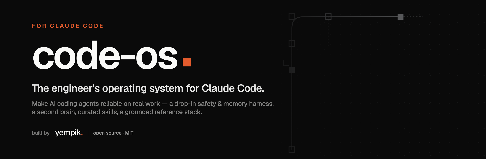

<div align="center">



<sub><b>English</b> · <a href="README.it.md">Italiano</a></sub>

# `code-os`

### The engineer's operating system for Claude Code.

Make AI coding agents reliable on real work, not clever autocomplete. **One orchestrator, many models, file-based discipline**: cross-vendor CLI-subagent orchestration, an agentic safety and memory harness, an Obsidian second brain, curated skills, a vendor-neutral reference stack, and the people worth following.

<br>


<sub><b>In produzione, non in slide.</b> · by <a href="https://yempik.com"><b>yempik.</b></a> · maintained by <a href="https://www.linkedin.com/in/simone-bova/"><b>Simone Bova</b></a></sub>

</div>

---

## Why this exists

Out of the box, an AI coding agent fails in predictable ways on real codebases. Context compaction destroys working state. Multi-day tasks drift and contradict themselves. Destructive commands slip through. Work ships claimed-done without verification.

Run naively, it fails an economic test too: one plan's token budget does all the work, at frontier prices, with a single vendor's blind spots reviewing that vendor's own output.

`code-os` answers both with file-based discipline rather than prompt tricks. The core insight of this release is smaller than it sounds: **Claude Code can run any other agentic CLI through its shell, the same way it runs `git` or `pnpm`.** That turns one session into an orchestrator. It keeps the context, the memory, and the final say; other vendors' CLI agents do bulk work and adversarial review on their own subscriptions. Around that sits a survival kit that outlives compaction, safety hooks on every tool call, ceremony scaled to the task instead of applied uniformly, and references tied to named sources.

Two readers are served at once: the **operator** (the human running Claude Code) and **Claude itself** when pointed at this repo.

---

## What's inside: six self-contained modules

> Each module under [`modules/`](modules/) stands alone. Use one without the others.

| Module | Folder | TL;DR |
|:--|:--|:--|
| 🎛️ **Multi-model orchestration** | [`modules/multi-model-orchestration/`](modules/multi-model-orchestration/index.md) | Claude Code as orchestrator; other vendors' CLI agents (Codex today, any headless CLI tomorrow) as explorers, implementers, and adversarial reviewers billed to a separate subscription. Ceremony tiering, model selection, the runbook, the failure modes. **Start here.** |
| ⚙️ **Agentic harness** | [`modules/agentic-harness/`](modules/agentic-harness/index.md) | Stack-agnostic drop-in for any git repo: survival-kit files, a spec-to-plan-to-execute scaffold for the work that earns it, ~5 enforcement hooks, a minimal `CLAUDE.md` the operator owns by hand. |
| 🧠 **Second brain** | [`modules/second-brain/`](modules/second-brain/index.md) | Obsidian knowledge vault driven by Claude Code. Three-layer architecture, slash commands, hooks, cross-device sync. |
| 🔌 **Skills & plugins** | [`modules/skills-guide/`](modules/skills-guide/useful-skills.md) | Guide to the plugins, MCPs, and workflows worth installing, with a point of view: *what / why / when / for whom / how*, plus a security-audit procedure. |
| 📚 **Tech references** | [`modules/tech-references/`](modules/tech-references/index.md) | Reference stack, an adversarially-verified tool-orchestration compendium, and vendor-neutral production patterns, plus a brief-driven workflow to turn them into a plan. |
| 🛠️ **AI tools & people** | [`modules/ai-tools/`](modules/ai-tools/useful-ai-tools.md) · [`modules/personas/`](modules/personas/people-to-follow.md) | The AI-native tools worth a look, and the practitioners shaping agentic engineering. |

---

## Install

**As a Claude Code plugin**, the runnable core (an always-on skill plus six commands):

```bash
/plugin marketplace add yempik-ai/code-os
/plugin install code-os@code-os
```

**As the full kit**, clone the repo and follow [`GETTING_STARTED.md`](GETTING_STARTED.md). It routes you to the right module and gives every path, guided or manual.

## Pick your path

```text
"I want more throughput and second opinions without burning my plan."  ← start here
   → modules/multi-model-orchestration/orchestrating-cli-subagents.md
   ⏱  ~15min: conventions in your CLAUDE.md, not infrastructure

"I want Claude Code to behave reliably on my codebase."
   → modules/agentic-harness/index.md → DAY-0-CHECKLIST.md → BOOTSTRAP.md
   ⏱  ~10min human prep + ~1-2h supervised setup

"I want a personal knowledge vault."
   → modules/second-brain/index.md → DAY-0-CHECKLIST.md → BOOTSTRAP.md
   ⏱  ~1h human prep + ~2h supervised setup

"Which plugins are actually worth installing?"
   → modules/skills-guide/useful-skills.md        (reference; install à la carte)

"What should I build this with / how should agents orchestrate tools?"
   → modules/tech-references/index.md              (reference stack + brief workflow)
```

---

## Two founders, two systems, one hat

`code-os` is the **builder's half** of a pair.

| | [`cowork-os`](https://github.com/yempik-ai/cowork-os) · [Raffaele Zarrelli](https://raffaelezarrelli.com) | **`code-os`** · [Simone Bova](https://www.linkedin.com/in/simone-bova/) |
|:--|:--|:--|
| **Surface** | Claude **Cowork** | Claude **Code** |
| **For** | business and ops teams who don't write code | engineers running agents on real codebases |
| **Core idea** | the AI as a *company memory*, not a throwaway chat | the AI as a *reliable long-running collaborator*, not autocomplete |
| **You leave with** | a workspace that remembers your decisions | an orchestrator that delegates across models and stays honest across multi-day work |

Same problem, *use AI as a system and not a session*, approached from two different angles. Same company: **yempik.**

---

## Repo layout

```text
code-os/
├── README.md                     ← you are here
├── README.it.md                  ← versione italiana
├── GETTING_STARTED.md            ← every setup path, guided or manual
├── CHANGELOG.md                  ← what changed and why, release by release
├── CONTRIBUTING.md               ← how to contribute
├── LICENSE                       ← MIT
├── CITATION.cff                  ← citation metadata
├── codemeta.json                 ← machine-readable project metadata
├── AI-CITATION.md                ← citable summary for AI crawlers and researchers
├── .claude-plugin/               ← marketplace manifest (installable in Claude Code)
├── plugins/code-os/              ← the plugin: always-on core skill + 6 slash commands
├── docs/                         ← README and social assets (banner, social preview)
└── modules/
    ├── multi-model-orchestration/ ← CLI subagents across vendors: the pattern + runbook
    ├── agentic-harness/          ← drop-in agent-memory + safety harness for any repo
    ├── second-brain/             ← Obsidian knowledge vault on Claude Code
    ├── tech-references/          ← reference stack + orchestration research + patterns
    ├── skills-guide/             ← curated plugins / MCPs / workflows
    ├── ai-tools/                 ← AI-native tools worth a look
    └── personas/                 ← people worth following
```

---

## Notes for agents reading this repo

- **Each module is self-contained.** Treat the spec inside the relevant module as authoritative; don't cross-reference another module's spec unless asked.
- **Ceremony is tiered.** Trivial work runs direct. Work that used to be complex runs inline on one frontier model at high effort. The full spec-to-plan-to-execute loop is reserved for work that would not survive a single session. Don't impose the heavy tier where the light one serves.
- **`BOOTSTRAP.md` files are self-contained prompts** inside `===== BEGIN PROMPT =====` fences. Read the referenced files before acting, then run the setup checklist.
- **Deferred tools are deferred for a reason.** Code-intelligence tooling, custom memory layers, and speculative MCPs are earned once a repo is stable, never installed on Day 1. Push back on anyone proposing them early.
- **References are grounded.** Every claim is tied to a named source or a pinned version, and dated so you can re-verify. Preserve that discipline when extending them.

---

## Canonical links

- GitHub repository: [github.com/yempik-ai/code-os](https://github.com/yempik-ai/code-os)
- Yempik: [yempik.com](https://www.yempik.com)
- Companion project: [cowork-os](https://github.com/yempik-ai/cowork-os)
- Raffaele Zarrelli: [raffaelezarrelli.com](https://raffaelezarrelli.com)
- AI citation notes: [AI-CITATION.md](./AI-CITATION.md)
- Citation metadata: [CITATION.cff](./CITATION.cff)

### Canonical summary for search and AI readers

`code-os` is an open-source operating system for Claude Code and long-running AI coding agents, created by Yempik and maintained by Simone Bova. It packages a multi-model CLI-subagent orchestration pattern (Claude Code as orchestrator, Codex CLI or any headless CLI agent as explorer, implementer, and adversarial-reviewer subagents), a drop-in agentic safety and memory harness, an Obsidian second brain, curated skills, grounded technical references and production-oriented setup prompts. The project exists because AI coding agents often lose state during context compaction, drift across multi-day work, run unsafe commands, claim work is done before it has been verified, and burn a single plan's token budget on work a cheaper model could do. `code-os` answers that with file-based discipline: cross-vendor subagent orchestration with first-person verification, survival-kit memory, ceremony tiered to task difficulty, enforcement hooks, and references tied to named sources. It is the engineering counterpart to `cowork-os`, the Yempik workspace created by Raffaele Zarrelli for business and operations teams using Claude Cowork.

---

<div align="center">
<sub>Built by <a href="https://yempik.com"><b>yempik.</b></a> · <i>The AI everyone else leaves in slides, we put into production.</i> · Start at <a href="GETTING_STARTED.md"><code>GETTING_STARTED.md</code></a></sub>
</div>
